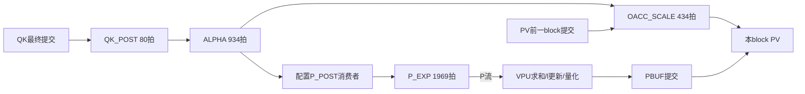

# VPU/SFU 接入审查与非矩阵隐藏方案

日期：2026-10-18。当前工作目录仅为 `DEA8`；`DEA8_zhao` 不属于本轮范围。生产 RTL 未修改。审查副本、独立 TB 和原始输出放在 `Pcore/.review/DEA8_VPU_20261018/`。

精简证据：[验收摘要](vpu_sfu_review_20261018/summary.json)、[输入哈希](vpu_sfu_review_20261018/inputs_sha256.json)。`.review/`已加入忽略规则，避免将克隆、商业IP生成产物和仿真缓存误上传。

## 1. 结论与证据边界

**旧接口版本已经有真实 PCore + VPU + SFU 的七 Job 功能链，不能再把它称为纯 TB 算术模型；当前 DEA8 的完整集成仍需验收。** 最大性能问题是 SFU 逐批排空流水，以及 PCore 的 G-U 单行在途约束。

| 项目 | 核对结论 |
|---|---|
| 被审查仓库 | [kayuenhuang/DEA8_VPU](https://github.com/kayuenhuang/DEA8_VPU) |
| 固定提交 | `dfe54efcdd704c0afd6f891099fc40239e774a02` |
| 原始联合验证的 PCore | `e12af5bdef23af8faa80c09a3520c73bf87e37b0`，旧独立外发接口 |
| 仓库声明静态兼容的 PCore | `86856b5c54ce41854e5dcf5a4e03d686b83fa520`，tx256 接口 |
| 本地生产基线 | `DEA8/Pcore`，双行 INT8、7级 MXU、11级 DEQACC |
| 原始日志 | FUNCTIONAL 与 STRESS 三个种子 20261014、7、101；每轮七 Job、265408 次矩阵发射、143 条 SFU 命令 |
| 原始证据完整性 | 上传包62个文件的 SHA256、67个非IP编译输入、四份原始完整日志的结束标记及错误检查核对通过 |
| 资源/频率 | 本轮未综合；不由功能仿真推断 U50 可容纳八套或已达到250 MHz |

首次克隆触发了换行符与清单不一致：62项上传包中34项须恢复LF；PCore依赖还有45项须恢复清单中的LF。审查脚本只在隔离副本选择与原清单 SHA256 完全相同的 LF/CRLF 形式，没有修改算法或绕过哈希检查。清单、Git文本属性及下载脚本下一轮应统一，避免正常克隆后无法复现。

## 2. 内部还有哪些 TB 参与

| 环节 | 实际执行者 | 当前TB参与 |
|---|---|---|
| Matrix、B/A加载、MXU、DEQACC | PCore真实RTL | 提供XBC、已拆包的HBM/KVB数据 |
| FACC/OACC、workspace、QOZ、G-U Pair BUF | PCore真实RTL | 监测读写、核对数值与生命周期 |
| QK mask/MAX/aa、P求和/l、OACC缩放、A_FIN量化 | VPU真实RTL | 独立参考答案、有效Mask输入、压力门控 |
| Q/K RoPE、V量化、GELU(G)乘U和Z量化 | VPU真实RTL | 核对坐标、量化轴、尾部及数值 |
| exp、GELU、reciprocal | SFU真实RTL与Vivado浮点IP | 数学函数只算golden，不驱动返回值 |
| RoPE系数 | SFU真实同步ROM | 提供base7的ROM文件与测试位置配置 |
| DEA8总控、GCore接收/commit、真实HBM | 联合测试台模型 | 本轮七Job测试的外部环境 |

关键源码证据：

- [联合TB 212行附近](https://github.com/kayuenhuang/DEA8_VPU/blob/dfe54efcdd704c0afd6f891099fc40239e774a02/tests/tb_pcore_vpu_sfu.sv#L212)：七种VPU操作都路由到真实VPU。
- [联合TB 1252行附近](https://github.com/kayuenhuang/DEA8_VPU/blob/dfe54efcdd704c0afd6f891099fc40239e774a02/tests/tb_pcore_vpu_sfu.sv#L1252)：误入旧行为模型分支先触发`$fatal`。旧任务定义仍在文件内，不代表它们参与正常七Job执行。
- [联合TB 1319行附近](https://github.com/kayuenhuang/DEA8_VPU/blob/dfe54efcdd704c0afd6f891099fc40239e774a02/tests/tb_pcore_vpu_sfu.sv#L1319)：真实SFU接收命令、访存并返回数据。
- [联合TB 1347行附近](https://github.com/kayuenhuang/DEA8_VPU/blob/dfe54efcdd704c0afd6f891099fc40239e774a02/tests/tb_pcore_vpu_sfu.sv#L1347)：`$exp`、`$sin`、`$cos`等仅作比较答案。正常七Job不使用`prepare_q()`的QOZ直接预置分支。

因此，“算术是不是由TB代算”这个问题，答案是正常七Job路径没有代算；“是否已是能直接接入当前DEA8的完整PCore”则仍有以下缺口。

## 3. 功能验收剩余缺口

### 3.1 当前版本完整联合回归

旧联合TB仍接`kv_hdr/kv_out136`和`reduce_hdr/reduce_out512`，当前PCore只暴露`tx_valid/ready/data256/last`。VPU/SFU command、data、done、ACC、workspace和RoPE类型没有随此次外发变化修改。

审查副本新增`current_tb.sv`，只补tx信号、连接现有`tb_packet_decode`以及提供K/V独立入口；原数值检查保留。该decoder仅属于TB，不是给生产PCore增加核外桥。

当前PCore四类外发已独立重跑：真实`dea8_pcore_output -> dea8_gcore_packet_rx`，K/V各2Tile，O/Down各64Tile；13418个总传输beat、6528个FP32行、8537个背压周期，全部通过。该测试不等于八个完整PCore整层推理。

### 3.2 Mask仍由TB提供

[VPU顶层28行](https://github.com/kayuenhuang/DEA8_VPU/blob/dfe54efcdd704c0afd6f891099fc40239e774a02/VPU/vpu_rtl/dea8_vpu_top.sv#L28)新增了`mask_config_valid`与`mask_config[50:0][15:0]`，文件头明确称其为本地接入钩子。当前`control_job_t`没有完整Mask配置来源。

TB规则是第0行全mask、最后block仅第15列mask。源码明确说明这不是正式AR/尾3token的系统合同。固定51个suffix token放进4个16-token block时，最后block应有13个padding槽；是否还需要state/action分组等规则，应按冻结模型语义和有效prefix信息确定，不能沿用该测试Mask。

下一轮须在PCore正式顶层接入或生成Mask：身份绑定context/job/head/block，数据在QK_POST接受时有效；保留全mask行策略。该项是正式Attention功能的一部分。

### 3.3 RoPE系数窗口不是通用服务

[SFU RoPE ROM](https://github.com/kayuenhuang/DEA8_VPU/blob/dfe54efcdd704c0afd6f891099fc40239e774a02/SFU/rtl/dea8_sfu_rope_rom.sv#L6)限制`POSITION_BASE .. POSITION_BASE+50`。仓库提供base7文件；SFU默认却是base816和另一个默认文件名。

这对指定51位置窗口可以正确工作，但正式实例必须显式匹配ROM文件与`job.position_base`；若实际位置随上下文变化，应提供系数加载/多窗口机制。K的分片仍遵守本核RoPE配对列映射，不改变既有列分配。

### 3.4 输入数值及取消覆盖还需加强

七Job主测试的A按行取-1/0/1，B多数是1/2/3且沿K重复，输入块scale固定128。该测试覆盖真实尺寸与数据链，却容易漏掉K维错序、转置/步长错误、不同块scale错配。压力种子主要改变等待，不会把这些矩阵输入变成随机模型张量。

下一轮增加按row/k/n区分的数据、正负INT8权重、不同块指数、非整齐K维贡献和真实padding Mask，并保持独立golden。现有GELU/ALPHA定向flush也不能替代七Job各阶段的系统级取消、迟到返回及重启检查。

仓库尚无一个已验收的生产顶层把控制、VPU、SFU及Mask/ROM配置统一封装；当前连接发生在TB。下一轮应在DEA8/Pcore内部完成正式顶层，保留现有七Job边界。

## 4. 周期：问题集中在哪里

以下均取仓库原始FUNCTIONAL日志，属于旧PCore接口场景；不是本轮新RTL性能，也不是板上时间。

| Job | 矩阵发射拍数 | 完整Job拍数 | 发射占完整Job |
|---|---:|---:|---:|
| K | 3328 | 4252 | 78.26% |
| V | 3328 | 3627 | 91.75% |
| Q | 26624 | 27594 | 96.48% |
| Attention | 45760 | 169483 | 26.99% |
| O | 26624 | 28277 | 94.15% |
| G-U | 106496 | 290394 | 36.67% |
| Down | 53248 | 54901 | 96.98% |
| 合计 | 265408 | 578528 | 45.88% |

Attention与G-U共占总周期约79.5%。它们的非发射周期合计307621拍，占全链非发射周期约98.2%；非发射周期也包括必要的加载、流水尾部与完成交接，不能全部称为无效计算。

注意两个统计口径：

- `matrix_util`只看首次至末次矩阵发射之间；`job_matrix_occupancy`才包括完整Job尾部。
- 当前TB对Q/Attention/G-U也打印`egress_tail`，但这些Job没有外发，计数起点仍为0，会出现累计绝对周期数。该字段不能用于判断这三类Job的外发瓶颈。

## 5. Attention根因与实测状态计数

新增`tb_sfu_audit.sv`使用真实SFU、真实`dea8_pcore_workspace`和真实浮点IP，TB仅预置输入、发命令及核对答案。四类命令全部完成，含全mask行和零l处理。

| 命令 | 实测拍数 | 读/写/结果包 | 主要状态 |
|---|---:|---|---|
| ALPHA_EXP | 934 | 51 / 51 / 0 | EPIPE 780拍，13批各等60拍 |
| P_EXP | 1969 | 102 / 0 / 26 | EPIPE 1738拍 |
| RECIP | 1990 | 51 / 51 / 0 | RPIPE 1836拍，51次各36拍 |
| GELU，直接送行 | 8876 | 0 / 0 / 51 | GPIPE 8772拍，邻行接受间隔174拍 |

### 5.1 SFU没有用上流水的连续发射能力

[SFU顶层](https://github.com/kayuenhuang/DEA8_VPU/blob/dfe54efcdd704c0afd6f891099fc40239e774a02/SFU/rtl/dea8_sfu_top.sv#L137)的`MREQ -> MRSP -> EPIPE/RPIPE -> MWR/RESULT`把整批访存、计算和写回串行。

- ALPHA虽已四行一批，但下一批仍要等本批exp全部返回。`13 × 60 = 780`拍都在EPIPE。
- P_EXP每次读一对行的Score和m，再发8组exp，等待整对输出并交付，才读下一对。完整对的EPIPE为67拍、末单行为63拍：`25 × 67 + 63 = 1738`。
- RECIP IP支持II=1，但控制器每行等倒数返回才处理下一行，`51 × 36 = 1836`拍。
- VPU的P_POST本身是流水消费者，实际1996拍约等于P_EXP的1969拍加27拍尾部，主要是在等SFU数据。

原日志中QK_POST约80拍、OACC_SCALE434拍、A_FIN439拍。QK与A_FIN已不是主要问题。`80+934+1969+27 = 3010`拍的生产链，无法按约434拍的单矩阵block窗口完全隐藏。

P_POST与P_EXP按流重叠，不能把1996拍与1969拍再相加；SCALE还受同一VPU命令槽的约束。已有模型VPU/SFU的PCore七Job日志中Attention约49257拍，说明PCore原本具备事件重叠机制，真实服务的吞吐和单行在途限制才是本次首要改动对象。

### 5.2 先改队列和读写方式，保留现有lane数

| 部分 | 下一轮设计 | 初始周期预算，待RTL验证 |
|---|---|---:|
| ALPHA | aa按16行一组读4次；13个四lane exp输入连续发射；alpha按16行打包写4次 | 约100拍 |
| P_EXP | m预读4次缓存在51项小存储；Score连续预取、两行FIFO；四lane exp连续发射；输出按两行打包 | 约275～300拍 |
| P_POST | 提前读l/alpha，接流做行和/量化；保留完成、写回和PBUF提交屏障 | P_EXP之后约27拍尾部，按实测复核 |
| RECIP | l读4次，51行以II=1进入倒数流水，recip打包写4次 | 约95～100拍 |
| SCALE / A_FIN | 优先复用已流水化32lane实现；保留真实读写完成条件 | 仍按434 / 439拍核算 |

这些预算包含流水延迟，不能只拿`816/4=204`拍当P_EXP完整时间。当前exp64路径为14拍减法加45拍exp，单独P_EXP即使连续输入也有约59拍尾部。

workspace已支持一次连续16行统计读写，尾项mask=0007；上述方案不要求改变它的572/560bit外部请求/响应类型。P_EXP的存储读次数可从102降为`51 Score + 4 m = 55`。m缓存约204字节；两行Score约128字节；另有小输出打包缓冲和行/组tag，先不复制完整Score Tile。

SFU每次仍只接一条宏观命令。命令内部使用读、发射、收结果、写回四套计数/小队列；反压时同时保持算术流水与旁带tag。无需首先增加SFU lane、复制完整矩阵存储或改七Job接口。

本阶段先保留当前数值精度：SFU端口是FP32，exp/GELU/reciprocal内部实际使用FP64 IP再RNE到FP32。上述逐位通过对应既定评估顺序和样本范围，尚无模型级量化精度结论。若后续换FP32或近似LUT，应单独冻结数值误差标准并验证，不能混作本轮控制优化。

### 5.3 保持事件依赖，给SCALE留调度余量

| 操作 | 必须等待的事件 |
|---|---|
| QK_POST(b) | QK(b)最终DEQACC提交；前代P_EXP已退出单代m/aa读取 |
| ALPHA(b) | QK_POST(b)的Score/m/aa可见；对应alpha bank可复用 |
| P_EXP(b) | alpha完成；P_POST(b)消费者已配置 |
| SCALE(b), b>0 | alpha(b)可见；PV(b-1)的OACC写回完成 |
| PV(b) | PBUF(b)完整提交；SCALE(b)完成 |
| A_FIN | PV54最终提交、recip完整可见；最后量化结果确实写入QOZ才done |

仍使用`QK0,QK1,PV0,...,QK54,PV53,尾部保护时隙,PV54`的110子任务顺序。alpha双代、PBUF双bank和单代m/aa的所有权屏障继续保留。不能提前报done或删掉PV53到PV54的保护时隙换取表面加速。

SCALE已测434拍，和参考block槽基本相等；P_POST和SCALE又共用同一VPU命令槽。应同时检查两block周期的总资源占用和各数据就绪时刻，不只检查每个函数是否小于434。允许数据尚未就绪时按ready/done等待；先接受少量交接余量。

审查中的`attention_budget.py`按现有单VPU/单SFU及依赖顺序做事件预算：现有阶段参数得到169297拍，与原日志169483拍相差约0.11%；改用alpha=100、P_EXP=300、RECIP=100后得到52744拍，较紧预算为50814拍。该模型忽略部分握手、供数及RAM冲突，**仅作方案预算，不作新RTL通过证据**。下一轮可先以完整Attention约5.5万拍、有效矩阵发射占比80%以上为目标，再决定是否追求更紧的block间隔。

## 6. G-U根因与最小修改方案

这里有两层互相强化的串行化：

1. [PCore post](../rtl/dea8_pcore_post.sv)只保留一行`up_q`，`gu_row_q`置位后不再接下一行，直到GELU返回并被VPU接受。
2. SFU顶层每行执行`GIN -> GPIPE -> RESULT -> GIN`；底层GELU虽已168拍延迟、II=1，顶层仍逐行排空。

单个G/U N-Tile有`128×26=3328`拍矩阵发射，SFU GELU整块却为8926拍，约`51×175`。因此下一Tile到达最终结果时Pair BUF还被上一个后处理占用，矩阵被迫等待。只优化底层GELU的几级延迟无法解决这个结构性问题。

### 推荐先做4行滑动信用窗口

- 整个51行仍是一条FUNCTION_GELU和一条VECTOR_GU_POST命令，外部七Job与命令语义不变。
- PCore把“已接收Gate/Up行”“Gate已送出行”“GELU已返回/配对行”改成独立计数，允许最多4行在途。
- 保存对应Up及行号；收到GELU后严格核对job/token/tile/index，与FIFO头Up配对送VPU。
- GU数据仍为`vector_valid=01`，first是同一行GELU(G)，second是该行U；不把second改解为另一行。
- SFU输入分组、算术发射、输出组装并行；能接新行时不必等待上一行全部返回。VPU已有GSTREAM乘法和后续量化路径可复用。
- 信用归还以GELU/Up配对被VPU实际接受为准。RAM写完、输出收齐与job done分别判断；flush只清有效位及在途身份。

逻辑Up容量为`4×16×32=2048bit=256字节`，无需新建Z BUF。可选择复用Pair BUF的Up存储并拆分读/释放所有权，或单独设置小Up队列。若优先用BRAM，可把Up内部组织为64bit×32，行数据分8拍存取；其带宽仍明显高于四行信用窗口约每40多拍一行的平均需求。具体物理映射下一轮再综合确认，不能把逻辑位数直接当RAM primitive数量。

以当前约174拍行周转估算，4行窗口平均约44拍/行，加上分组、Up存取、最终量化及余量，整块后处理约2300～2600拍，有希望隐藏在下一N-Tile的约3328拍矩阵窗口中。先验收`post<=3000拍`及不堵塞下一次结果槽预约；若余量不足再增至8行。2行窗口约87拍/行，通常不足以隐藏。

完整G-U初始目标可定约11.2万拍以内，实际以新RTL无断供测量为准。最后一个N-Tile的后处理尾部仍需计入Job，不能声称100%隐藏。

## 7. 本轮新增验证记录

审查目录：`../.review/DEA8_VPU_20261018/`。

| 验证 | 本轮结果/证据 |
|---|---|
| 原始包与日志 | `audit_tools.py prepare`及仓库`verify_package.py`严格通过；四轮完整七Job是原始证据，和本轮新运行区分 |
| VPU独立数值 | [日志](vpu_sfu_review_20261018/vpu_numeric.txt)：4096加法、4096乘法、512组B16量化，与NumPy逐位比较全部通过，含特殊值、次正规数和反压 |
| SFU控制与真实workspace | [日志](vpu_sfu_review_20261018/sfu_schedule.txt)：4类命令、完整51行、P尾行、全mask及零l；通过并得到第5节状态计数 |
| 当前PCore外发到真实GCore RX | [日志](vpu_sfu_review_20261018/current_output_link.txt)：K/V/O/Down全部通过，13418总beat |
| 当前PCore+真实VPU/SFU的K/V | [日志](vpu_sfu_review_20261018/current_kv.txt)：新tx256，6656次真实矩阵发射、K4252拍/V3627拍；K/V数值、坐标、尾部、顺序和commit检查均通过 |
| 旧完整七Job本轮复现 | `upstream/build/sim_functional_20261014_20261018_173959_343075/`：新复现K/V/Q分别4252/3627/27594拍；之后主动结束额外长回归，不计本轮完整七JobPASS。见`baseline_partial_status.json` |
| GELU独立原测试复现 | [日志](vpu_sfu_review_20261018/gelu_numeric.txt)：4128次严格比较、7次flush、35拍输出背压；168拍、II=1，全部通过 |
| 生产RTL一致性 | `production_rtl_before.json`与结束前哈希核对：44份PCore RTL均未修改 |

独立VPU测试初版的动态双层打包赋值没有正确驱动第二行，改为显式两行赋值后输入及结果全部核对通过；早期失败不作为RTL缺陷。完整联合TB的O1/O2展开触发Vivado2022.2 LLVM内部断言，O0正常；这与数值断言失败分开记录。本轮没有为绕过仿真器而改生产RTL。

## 8. 下一轮实施顺序

1. 在`DEA8/Pcore`接入正式VPU/SFU顶层及Mask/RoPE配置；保留当前tx256；用更新后的完整七Job TB验收。
2. 优先改G-U的4行信用窗口，保留单条宏观命令及现有51行Pair BUF/QOZ复用。
3. SFU依次改统计向量读写、连续RECIP、连续P_EXP和ALPHA；先保留当前数值精度和舍入顺序。
4. 用真实延迟重验Attention队列及SCALE截止时间；必要时允许少量block交接余量，保持所有权与尾部保护。
5. 数值输入扩充、三压力种子、各Job取消/flush/restart、纯性能模式统一验收；记录P等待、SCALE等待、A/B断供与FACC占用，不能只看总拍数。

整个过程沿用DEA8设计名称，修改位置限定DEA8；不引入下一版设计，也不以降低数值检查或TB提前done实现加速。
