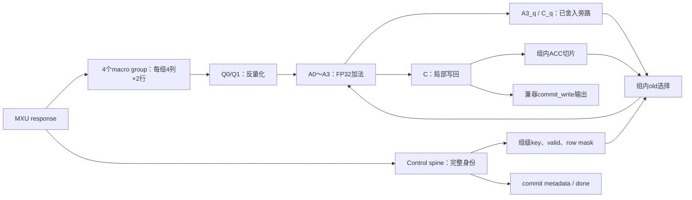

# DEQACC V1 优化设计方案

设计日期：2026-10-12。当前状态：**RTL与功能仿真完成，物理时序未验证**。

执行状态更新（2026-10-13）：V1 RTL与仿真已完成，见 [实现报告](DEQACC_V1_优化方案.report.md)。下文保留设计时的约束与目标；七级/II=1/四拍反馈已有行为仿真证据，250MHz与物理routing仍未验证。本轮用户明确要求不做综合/P&R。

输入方案：`interaction/DEQACC结构方案V1.docx`。工作目录：`VLA/DEQACC/`。`VLA/DEA8/` 保持冻结；旧 routing 工程保留为参考，本方案另起 V1 模块，不覆盖旧实现。

## 1. V1 定义与本次优化结论

推荐 V1：**32 lane / 4 个 macro group × 8 lane / Q0、Q1、A0、A1、A2、A3、C / 7 级 / 250 MHz**。

- 无 RAW 依赖的输入流：目标 II=1，每拍处理两行 × 16 列
- 单一 ACC 地址的累加链：目标最小输入间隔 4 拍；通过 A3 已舍入结果直接反馈到 A0 实现
- 数值：每次反量化、每次 FP32 加法、累加顺序与冻结参考 bit-for-bit 一致
- 物理组织：4 列一个 macro group；内部两组 2 列 micro-cluster，数据与 ACC 切片局部连接
- 完成：C 同拍更新所有有效切片，并输出匹配的 commit identity 与 write bundle

7 级、II=1 与反馈间隔是三个不同指标。II=1 不代表同地址相邻两拍都能累加；4 拍反馈也不保证动态 M 的所有工作负载无气泡。

### 初稿中需要修正的地方

| 初稿表述 | 优化后的约束 |
| --- | --- |
| old_fetch_q → old_issue_q → A0 | RAM 输出寄存视为 fetch；A0 的输入/解码寄存视为 issue，不额外串接两级 |
| A3 → forward_q 即可四拍反馈 | A0 必须能直接读取上拍已产生的 A3_q；C_q 提供上一笔 commit 旁路 |
| FAR 只需 carry/right-shift | 同号加法可能右移一位；异号且有效指数差≥2的减法仍可能左移一位 |
| 只比较 bank/address/parity 就取最新 | 先检查最年轻的同地址有效写者是否已完成，再选择旁路；不能绕过未完成写者 |
| valid map 必须四份 | 宏组内局部 bitmap 作为候选，和共享 bitmap＋局部读状态对比资源与路由 |
| B4 是当前工程事实 | 当前副本是 B2→B1 serializer、每次 load 一列；4列分组是 V1 物理设计选择 |
| KTile 稳态4.25～4.5拍 | 是输入方案的系统假设，当前副本未提供对应实测依据；验收使用实际同地址间隔 |
| 不汇聚1024-bit结果总线 | 内部反馈与 RAM 写回不经过中央总线；保留既有1024-bit commit_write兼容输出 |

## 2. 当前基线与可复用内容

### 已存在的参考

| 文件 | 用途 |
| --- | --- |
| [旧 DEQACC 顶层](Pcore/rtl/DEQACC_3.3ns.sv) | 11级控制、ACC 接口、commit_write 与 hazard 断言参考 |
| [旧两列组](Pcore/rtl/DEQACC_3.3ns_group2.sv) | 反量化、局部 sideband 和两列层次参考 |
| [旧六级 FPADD](Pcore/rtl/DEQACC_3.3ns_lane.sv) | 加法分类、bypass、signed zero 与特殊值参考 |
| [冻结数值参考](Pcore/tb/fp32_legacy_ref_pkg.sv) | 独立 TB golden；不得随 V1 修改 |
| [当前 FP32 package](Pcore/rtl/dea8_fp32_pkg.sv) | 辅助运算和旧实现语义，不能作为唯一独立 golden |
| [ACC 存储](Pcore/rtl/dea8_acc_store.sv) | 三 bank、两 parity、同步 RAM、并发外部访问参考 |
| [公共类型](Pcore/rtl/pcore_pkg.sv) | mxu_rsp_t、pair_meta_t、acc_write_t、地址映射 |

当前固定 profile：`TILE=16`、`ROWS=51`、`PAIRS=26`，fold 为 signed 6 bit。矩阵接口已经有动态 `job_m_rows`，但 ACC 存储深度仍按物理 profile 分配。

### R11 的真实证据

- 5000 笔、32 lane：bit-exact，11级，II=1；旧 stream 测试同地址复用相隔较远，不能证明四拍反馈
- ACC overlap：442 次并发读、442 次并发写、冲突重试、odd depth=400；已补 validity/clear/越界检查
- OOC timing shell，`xcu50-fsvh2104-2-e`：3.3 ns WNS=+0.094 ns；4.0 ns WNS=+0.794 ns，TNS=0，hold满足
- 含 shell：36,543 LUT、24,601 FF、1,280 LUTRAM、1,429 SRL、16 RAMB36

R11 部分路径：

| 终点级 | Logic ns | Route ns | Total ns | 最坏路径来源 |
| --- | ---: | ---: | ---: | --- |
| D0 | 0.400 | 2.586 | 2.986 | 入口 e_stream 广播 |
| D1 | 0.644 | 1.680 | 2.324 | 局部 exponent |
| D3 | 0.811 | 2.025 | 2.836 | pack finish |
| ACC | 0.245 | 2.456 | 2.701 | 外部写地址到 BRAM 写使能 |

证据：[R11 stages](Pcore/reports/routing_R11/stages.csv)、[250MHz timing](Pcore/reports/routing_R11/timing_250MHz.rpt)、[资源](Pcore/reports/routing_R11/utilization.rpt)。初稿中的 D1=2.095 ns 和 ACC reset route≈3.09 ns 来自早先候选，不代表最终 R11。

旧 OOC shell 没有捕获完整 commit_write 输出，且有 HD.CLK_SRC/边界位置警告；V1 需补完整输出观测，再区分可比的共同路径与新增边界路径。R11 OOC PASS 不等于完整 PCore/板级时序签核。

## 3. 四列物理分组与身份管理

`lane = 2*column + row`，row=0/1；外部数据仍按 `[row][column]`，只在组边界映射。

| Group | Columns | Lanes | 每个 parity 的 ACC 宽度 |
| --- | --- | --- | ---: |
| G0 | 0～3 | 0～7 | 128 bit |
| G1 | 4～7 | 8～15 | 128 bit |
| G2 | 8～11 | 16～23 | 128 bit |
| G3 | 12～15 | 24～31 | 128 bit |

每组：256-bit psum、两行8-bit Ea、四列8-bit Eb、256-bit old、256-bit result。内部每个 micro-cluster拥有两列×两行与对应64-bit parity RAM切片，不增加协议或stage。



完整 `pair_meta_t` 只沿 control spine；不要发明现有类型里没有的 job_id/k_tile字段。lane只接 psum、scale/fold、partial、old、valid/bypass。

组级控制必须含 bank、物理addr、row_valid、add_old、valid，以及 local context generation/issue顺序信息。这些用于 memory/forwarding，不进入浮点算术。

入口局部 scale/base寄存在Q0边界；避免为了locality在Q0前增加一拍。共享Ea/fold的RTL副本数量不等于综合后真实fanout，需检查是否被合并、实际load与clock-region跨度。优先保留组层次；仅对小型必要控制副本用keep/dont_touch。

## 4. 七级流水与精确时序

约定：事务 T 在上升沿 `e0` 被接受，Q0在该沿写入。表中状态均指沿后NBA完成的值。接收端在沿 `e7` 采样C输出，按既有TB约定记为7级延迟；沿后观察首次valid位于e6，两个定义不得混用。

| 沿 | 写入寄存级 | 算术 | ACC/身份动作 |
| --- | --- | --- | --- |
| e0 | Q0 | abs/lead/base_exp/special | 接收T；保存组级地址、bank、mask |
| e1 | Q1 | direct scale、RNE、partial pack | 用Q0控制发同步RAM读；RAM输出寄存在本沿更新 |
| e2 | A0 | 选择old；decode/order/path select | RAM候选＋A3_q＋C_q匹配T；检查未完成RAW |
| e3 | A1 | FAR align/add/sub；CLOSE 0/1 align/sub | 身份、bypass、valid同拍推进 |
| e4 | A2 | path-specific normalize/GRS | 无未舍入数据写ACC或用于feedback |
| e5 | A3 | RNE/pack、special/bypass | A3_q沿后是可用的已舍入旁路源 |
| e6 | C | 捕获最终结果，无新浮点计算 | 本沿RAM写入；commit_valid/meta/write/done沿后对齐 |
| e7 | 外部采样 | — | 下游采样T的commit bundle |

### old-ACC 的“取”和“送”如何落地

- RAM输出寄存是 `old_fetch`，更新在e1；Q1 partial也是e1更新
- e1～e2间完成old旁路选择与A0解码；A0寄存就是 `old_issue`
- 不在RAM输出与A0之间额外插入fetch、issue两套寄存，否则七级目标失效
- RAM配置必须保持一个同步读边界；不得悄悄启用额外BRAM输出寄存
- 初稿的“Q0发读”在这里定义为Q0提供请求、下一沿e1执行读，以使用局部Q0控制并隐藏延迟

若e1读路径与e2旁路＋decode不能达到4ns，报告该路径实测；先优化局部选择，不以增加隐藏stage维持“7级”名称。

## 5. Q0/Q1：直接反量化

输入实值：`signed(psum) × 2^(Ea + Eb + fold - 266)`。保留冻结参考的特殊值优先级。

### Q0：分开 magnitude 与 scale

- `mag`：unsigned 32 bit；`INT_MIN` 的abs必须为 `0x80000000`，不能用signed abs丢失该值
- `lead=floor(log2(mag))`；mag=0时lead可置0，但必须用zero标志避免正常路径影响
- 每组先算每行 `Ea + fold - 266`，再与每列Eb相加；base_exp可在组内按row/column组合，避免复制不必要的完整身份
- `Ebase=Ea+Eb+fold-266`，finite-scale范围−298～273；含255标记时可到275
- `E=Ebase+lead`；signed 11 bit足够容纳当前域，移位控制/取负建议signed 12 bit
- 加法前显式zero/sign extension；不要让8-bit或6-bit表达式先截断再赋给宽寄存
- `bad_scale=(Ea==255)||(Eb==255)`，不把scale字段当成普通FP32 exponent重新解释

### Q1：normal 与 subnormal

| 路径 | 条件 | 位对齐与舍入 |
| --- | --- | --- |
| Normal | `E≥−126` | `SN=lead−23`；SN>0右移并RNE，否则无损左移；处理24-bit mantissa carry和overflow |
| Subnormal | `E<−126` | `SS=−(Ebase+149)`；SS>0右移并RNE，否则无损左移；结果达到`0x800000`时输出min-normal |

Subnormal 的SS也可能是负数，不能只实现右移。当前域里SS最大149；移位量不能截成5bit，超界时按显式零/guard/sticky规则处理。

右移舍入：`inc = guard && (sticky || kept[0])`；sticky为guard以下所有有效位的OR。dist=0、dist=32、dist>32分别处理，不允许负下标或“移32变移0”。保留carry位后再pack；Normal和Subnormal仅走一次最终舍入，不能先round normal再round subnormal。

优先级：

1. bad_scale → canonical `0x7fc00000`，即使psum为0
2. psum=0且scale有效 → `+0`
3. 非零负值下溢到零 → 保留sign，得到`−0`
4. subnormal、min-normal过渡、normal、overflow → 与参考一致

直接公式在数学上可由旧normalize流程推导，但RTL等价仍需全域边界/随机验证；不能凭公式替代bit-exact验收。

首批定向向量（期望值按上述公式与冻结语义推导，不是V1实测）：

| psum | Ea / Eb / fold | 期望FP32 | 检查点 |
| --- | --- | --- | --- |
| `0` | `255 / 0 / 0` | `0x7fc00000` | bad_scale优先于zero |
| `−2147483648` | `133 / 133 / 0` | `0xcf000000` | INT_MIN unsigned magnitude |
| `1` | `70 / 69 / 0` | `0x00400000` | subnormal中的左移，SS=−22 |
| `−1` | `58 / 58 / 0` | `0x80000000` | 半个最小subnormal，tie-to-even得到−0 |
| `16777215` | `58 / 58 / 0` | `0x00800000` | subnormal舍入至min-normal |
| `16777217` | `133 / 133 / 0` | `0x4b800000` | normal tie-to-even |

## 6. A0～A3：四级 FAR/CLOSE 加法

Golden是冻结参考对每次加法的位结果，不承诺当前项目未实现的动态舍入模式、异常flags或NaN payload传播。

### A0：decode、旁路、order

old先在组级选择，再送lane解码；算术lane不做地址CAM。

- `add_old=0`：保存partial位模式，四级后原样输出；不能等价替换成partial+0
- effective exponent：exp=0映射为1；subnormal隐藏位为0，其余finite隐藏位为1
- 按effective exponent、mantissa决定big/small；相等时沿用参考的优先级
- special优先识别NaN与Inf；普通算术结果不得覆盖special
- `CLOSE = signs_differ && effective_diff<=1`；其他finite操作走FAR

### A1：对齐与主算术

- FAR：保留参考28-bit格式 `{0,mantissa[23:0],3'b0}`；small做right-shift-jam后add/sub
- CLOSE：差0/1，尾部扩展保证对齐不丢有效信息，再subtract；输出zero和分组nonzero摘要
- 全量LZD不强制与subtract串在A1；可先产生分组摘要，A2完成精确LZD
- V1首版使用精确LZD；LZA属于实测后可选优化，不能省略纠错而改变结果

### A2：归一化

| 路径 | 必须处理 |
| --- | --- |
| FAR同号加法 | carry-out时右移1并jam；无carry时保持；低指数subnormal保留正确隐藏位状态 |
| FAR异号减法、diff≥2 | 可能需要左移1，并减指数；不能一律保持指数 |
| CLOSE | 精确LZD、左移；shift最多`effective_exponent−1`，避免跨越subnormal下限 |

异号FAR例子：`1.0 − nextDown(0.5)`，指数差2，但结果最高位比1.0低一位。该例必须成为定向测试。

A2统一输出：未舍入significand、exponent、GRS、zero/sign、special、bypass。CLOSE左移不能把早先jam压缩的有效信息当成可恢复尾数；当前0/1对齐保留精确信息，FAR则坚持与参考相同的jam行为。

### A3：RNE与pack

- finite只在此处舍入一次；round carry修正指数，subnormal可round至min-normal
- overflow → 同号Inf
- 任意NaN输入、异号Inf相加 → canonical `0x7fc00000`
- 单个Inf → 保留其sign
- exact cancellation → 参考的zero sign：仅两输入sign均为1时为−0，否则+0
- bypass优先返回原partial位模式，包括signed zero/NaN位模式

所有这些数据跟随valid固定推进；无内部可变延迟、无按lane停顿。

累加顺序示例：`fl(fl(2^24 + 1) − 2^24)=0`，而高精度融合后最后舍入会得到1。V1必须保留前者，包括使用forwarding时每一步的A3舍入。

## 7. ACC、局部写回与外部兼容

### 物理布局

每macro group三类bank：FACC-A、FACC-B、OACC；每bank分even/odd。当前profile：

| Bank | Even深度 | Odd深度 | 地址 |
| --- | ---: | ---: | --- |
| FACC-A/B | 26 | 25 | pair_idx |
| OACC | 416 | 400 | `pair_idx*16 + nt` |

每parity slice逻辑128 bit，物理可以拆成两块64 bit。OACC采用BRAM候选，浅FACC保留distributed RAM候选；不假定每个slice必然对应固定数量的BRAM，核对实际推断与利用率。

`nt`必须在0～15；不允许截断非法nt后别名到合法地址。动态M只影响有效pair/mask与调度；V1不改变OACC stride或现有odd深度语义。要支持M>51需另行定义存储profile。

### validity与复位

- data RAM不reset；clear同沿清pipeline valid、旁路valid、hazard/context有效状态与逻辑word validity
- 首版可用每macro group共享于两个micro-cluster的bitmap；不可扩成每lane一份
- 做一次局部bitmap与共享bitmap＋局部initialized_q对比；四组复制必须量化FF、译码LUT和reset路由成本
- invalid-old=0在局部registered select实现，不让单bit控制整条中央1024-bit数据路径
- parity mask控制真正RAM写入与forward有效位；未写parity保留之前内容
- write有效性等于事务valid AND row_valid AND合法地址；clear/reset与写同沿时清空优先
- generation用于防跨context旁路，不替代RAM清空。更换generation而未清RAM，不会自动获得全零ACC

当前profile一个完整bitmap集合为 `2*(26+25)+(416+400)=918 bit`。四macro各一份为3,672 bit，比共享形式多2,754个逻辑valid位；这些只是状态位预算，译码/读mux和布局成本还需综合实测。按parity读写同地址共享，禁止将同一bitmap再按64-bit primitive机械复制。

### C与输出

每组在同一C沿写本地slice。全局commit只有四组都对齐时才有效；不允许某组提前/延后写、中央仍报告成功。

保留 `commit_valid`、`done`、`pair_meta_t` 和 `acc_write_t` 的外部语义。`done=commit_valid && meta.last`，valid同沿禁止clear后迟到commit。

内部不汇聚数据后再分发RAM，但外部 `commit_write.data[2][16]` 仍需按组接出：G-U pair buffer等消费者依赖它。允许组内C寄存直接驱动各自bundle切片，禁止再串接一个“中央输出寄存”增加第8级。P&R shell必须把这些切片真正捕获，避免优化裁剪。

外部 result读/VPU写沿用ready/valid与三bank仲裁。现有Matrix wrapper会在整个Job期间预留bank；V1局部并发测试也需在DEQACC入口禁止访问任何未完成事务所占bank，不只检查当拍RAM读写冲突。不同bank仍可并发。

## 8. 四拍反馈：旁路与RAW规则

### 同地址四拍的逐沿推导

T在e0进入，后继U在e4进入：

| 沿 | T | U | 含义 |
| --- | --- | --- | --- |
| e4 | A2 | Q0 | U已接受，但不能在此时取尚未完成的T数据 |
| e5 | A3 | Q1/RAM read | T沿后得到已舍入A3_q；U的RAM候选可能仍旧 |
| e6 | C/RAM write | A0 | U在沿前选择T的A3_q，再decode；不依赖本沿才产生的C_q |
| e7 | 完成输出采样 | A1 | U继续固定流水 |

因此最小输入间隔4拍的关键路径是 **A3_q → 组级旁路选择 → A0 decode → A0_q**，要单独做post-route验收。

若额外 `forward_q` 在e6才捕获T，U的A0同在e6将读取旧forward_q，四拍承诺失败。首版不增加这个串行边界。

### 旁路源与优先级

在当前A0沿前，根据物理key与parity分别选择：

1. 最新较老的同地址写者仍在Q/A未完成级：不可选旧结果，视为未解决RAW
2. 最新写者已在A3_q：使用其最终RNE数据
3. 最新写者在C_q、与前一沿RAM读相撞：使用C_q的已提交数据
4. 无更新写者：使用同步RAM候选；invalid时为0

首版保留A3_q和C_q两个数据源。C_q既是commit输出，也是上一笔写回历史，不再另造深度CAM。Δ=5时U读RAM可能与T写RAM同沿，C_q解决read-first旧值；Δ≥6正常走已更新RAM。若读口实现不同，此表须用TB确认。

key：`context_generation + acc_sel + physical_addr + parity`。完整epoch/head/mode身份由control spine保留；上游Job/context切换与generation推进必须有明确事件，不用不足以唯一识别Job的字段拼一个“看似唯一”key。

同一group的8个lane共享匹配结果，每个parity仅在producer row_valid有效时参与；两parity来源可能不同。最新匹配以流水顺序判断，不按FP32数值或仅按一个last-result寄存判断。

`add_old=0`不读取前值，但仍是后继的有效producer。同地址多笔replace/write也要按顺序commit，不能跳过较新的replace结果。

### 接收规则与接口兼容

当前MXU response没有ready，V1不得接收后在A0发现RAW再“临时暂停”，这会破坏七级固定延迟。

- 独立地址连续输入允许II=1
- 同parity读改写链输入间隔必须≥4拍；<4拍依赖流由上游在进入MXU前stall/预留
- 独立测试用hazard断言拒绝不合法流；不要静默丢事务或取RAM旧值
- scoreboarding检查最近在途事务中同key有效parity；接收时检查“到达A0沿是否能满足”，不能要求producer在Q0接收沿就已完成；clear/context reuse时全清
- 新Job须等旧pipeline drain或走明确flush流程；不能仅切epoch就覆盖同物理ACC

V1首版保持旧response端口不新增ready。若真实动态M trace出现<4拍复用，报告需要上游节流的条件；调度修改仅在DEQACC独立副本集成阶段进行，禁止偷偷改DEA8。

同地址每拍连续累加的throughput上限受反馈环制约，不能靠队列掩盖长期到达速率超过处理速率。要做到同地址II=1需另一个架构，不属本V1承诺。

## 9. 物理与性能验收

### 测量范围

1. 单lane：Q0/Q1、A0～A3各logic/route与boundary
2. 四组完整DEQACC：ACC、所有反馈源、metadata、C、完整commit_write输出
3. DEQACC副本中的Matrix集成：真实psum/Ea输入、外部读写、commit消费者

每轮记录：WNS/TNS/WHS/THS、各级top10、fanout/load类型、拥塞、LUT/FF/LUTRAM/BRAM/SRL、组clock-region分布、实际RAM模式和RDW语义、源码hash、约束与工具版本。

250MHz硬门槛：4.0ns post-route setup/hold全部满足，TNS/THS=0、unrouted/partially-routed=0；DRC无错误。3.3ns仅作为额外余量观察，不替代4.0ns验收。

旧级数减少不意味着delay可相加后直接预测；Q1、A1、A2、A3反馈到A0均是新组合路径。以下均为目标，必须由V1实测支持：

- 7级commit；每个数据切片和metadata无off-by-one
- 独立地址无气泡II=1；同parityΔ=4/5/6/7准确累加
- 固定与动态M的实际trace，记录最小同地址间隔、RAW stall周期、矩阵issue占比
- 使用M={1,2,3,7,16,31,51}的合法row masks与profile，不预设B4吞吐

优先优化局部复制、shifter/round结构、精准层次。coarse Pblock为有成本的候选，先看无Pblock结果；R4已显示硬区域可加长reset与输入广播，不默认强行复用它。

若4ns未过，定位真实级与fanout后处理；仍无法过时记录7级目标未达到，不改clock约束、golden、延迟计数来制造PASS。6级、A2+A3合并、recoded/fused accumulator留给后续版本。

## 10. 实施顺序与验证门槛

验证方式：**分层真实仿真＋源码复查＋post-route（smoke-and-read流程）**。先跑最小算术核与依赖流，确定结构有效后再跑Matrix/七Job，避免每次改lane都重跑长全链；数值/依赖是架构变化，必须保留有意义的TB检查。

| 阶段 | 工作与拟建文件 | 通过条件 |
| --- | --- | --- |
| S0 | 记录旧RTL/golden hash、R11报告；单独`deqacc_v1.f` | 旧源码、golden、冻结DEA8未变 |
| S1 | `dequant_lane_v1.sv`：Q0/Q1；`tb_dequant_v1.sv` | scale全域边界、random bit-exact；2级II=1；Q1实际4ns |
| S2 | `fp32_add_lane_v1.sv`：dual-path；`tb_fp32_add_v1.sv` | special/bypass/FAR/CLOSE/RNE与旧六级逐笔一致；4级II=1 |
| S3 | `deqacc_v1_group8.sv`、`acc_slice_v1.sv`、`deqacc_v1_control.sv`、`DEQACC_V1.sv` | 无依赖32-lane连续流、7级、完整commit/data/identity对齐 |
| S4 | A3/C旁路、组级key/hazard；`tb_deqacc_v1_stream.sv` | Δ=4/5/6/7多key、partial masks正确；Δ<4诊断不合法流 |
| S5 | 四组OOC shell与实现脚本 | 全输出未裁剪；各级/feedback/ACC与4nssetup/hold完成 |
| S6 | DEQACC副本中的可选V1集成、Matrix trace与七Job | 守住累加顺序、外部并发、done尾部；报告动态M RAW边界 |

拟建RTL/TB放 `DEQACC/Pcore/rtl/`、`tb/`。新文件清单与顶层选择独立，首次集成不改全局旧 `DEQACC_PIPE_STAGES=11`；用V1显式7级常量/参数。只在选择V1的副本路径更新MXU/DEQACC tail预算，保留A11回归入口。

### 必须覆盖的数值与结构场景

- Dequant：0、±1、INT_MIN/MAX；Ea/Eb=0/1/254/255；fold=−32/−1/0/31；normal/subnormal边界、half-ULP tie、carry、underflow、overflow
- FPADD：diff=0/1/2/27/28/255、异号接近抵消、equal magnitude、FAR一位左移、normal/subnormal、±0、sNaN/qNaN、±Inf、roundcarry
- 数据流：逐lane不同输入，四组不串列；odd tail mask、不同bank/address、连续bubble、最后一笔done
- Feedback：依赖间隔4/5/6/7；A3最新值、C/RAM同沿冲突、被更年轻写者遮挡的旧匹配、add_old=0 producer、两parity不同producer
- 状态：pipeline在途clear、RAM已写clear、context reuse、非法地址、单parity写、外部异bank并发、同bank未完成事务反压
- 对照：安全旧间隔流同时喂A11/V1，按事务序号比较commit；新增Δ4流用顺序golden，不能强迫旧A11接受其原先禁止的RAW

清空时整个scoreboard/模型同时失效；clear前未完成事务不计作“丢失”，但不得clear后产生旧commit。对bubble后保留位只检查valid时的数据，避免把无效周期噪声当数值错误。

逐层零mismatch才前进。随机数量、seed、case计数写入日志；“很多随机PASS”不能替代明确边界或forwarding定向case。

## 11. 环境、交付与合并条件

- Vivado 2022.2；器件`xcu50-fsvh2104-2-e`；4ns时钟
- PowerShell 5.1调用cmd；所有xvlog/xelab/xsim/vivado在同一cmd先call settings64
- 禁止手工PATH/RDI/TCL_LIBRARY、禁止直接调用unwrapped可执行文件；timeout至少300000ms

执行模板（命令和snapshot名称由新增文件清单确定，不在未实现前宣称可运行）：

```powershell
& $env:ComSpec /d /c 'call "D:\Xilinx\Vivado\2022.2\settings64.bat" && call "D:\Xilinx\Vivado\2022.2\bin\xvlog.bat" -sv -f deqacc_v1.f'
```

Shell工作目录设为`C:\Users\fly04\Desktop\VLA\DEQACC\Pcore`。等号参数优先用options文件；返回码必须结合PASS/Fatal/Error判断，不能只看XSim exit=0。

后续执行交付：V1 RTL/独立filelist、定向与随机测试日志、完整P&R报告、源码hash、复现命令、`DEQACC_V1_优化方案.report.md`（待执行时创建）。报告逐阶段列完成/部分/未动、证据、偏离与剩余问题，不把目标写成实测。

本次仅产出方案。所有仿真与P&R仍是旧R11证据；没有V1的验证结果，也没有执行合并或GitHub推送。

合并进入DEA8需后续明确授权，并满足数值、时序、合法依赖流和副本集成验收；授权前保留V1在DEQACC独立工程。

## 12. 可复制的后续执行提示

```text
在 C:\Users\fly04\Desktop\VLA\DEQACC 内实施 DEQACC V1。
先读 VLA/AGENTS.md、DEQACC/DEQACC_V1_优化方案.md 与其中列出的现有RTL/TB。
按S0～S6执行，不重新决定已经确定的32-lane/4×8/七级结构。
旧A11与冻结golden保持可回归；新增V1独立模块与filelist，不覆盖旧实现。
Q0/Q1直接反量化，A0～A3 FAR/CLOSE；保持旧RNE、special、bypass和逐次累加顺序。
严格按逐沿表：RAM输出作为fetch，A0作为issue；不增加隐藏stage。
A0优先匹配已舍入A3_q/C_q，不绕过更年轻未完成writer；同地址依赖输入最小4拍。
无ready的MXU response不接收后stall；发现上游<4拍非法RAW流，先报告所需节流条件。
先lane/stream实际仿真，再完整post-route和DEQACC副本Matrix集成；禁止改测试标准。
Vivado工具通过同一cmd先call settings64.bat，再call工具bat；timeout>=300000ms。
禁止手工PATH/RDI/TCL变量与直接unwrapped入口。工作仅DEQACC，DEA8冻结，不推送不合并。
报告写DEQACC/DEQACC_V1_优化方案.report.md，含各阶段状态、证据、源码hash、命令与问题。
新证据若否定七级/四拍/4ns约束，先明确报告，不能靠改计数或约束伪造通过。
```
